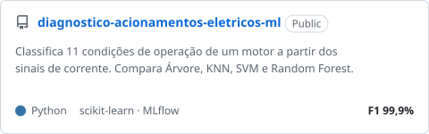
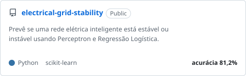
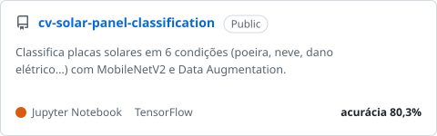
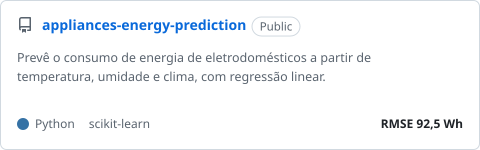

  

  

  
  
  
  

 

<table>
<tr>
<td width="62%" valign="top">

### Sobre mim

Sou estudante de Engenharia Elétrica na UFCG. Meu interesse principal é sistemas de potência, em especial transmissão de energia, e gosto de trabalho prático: bancada, campo e simulação.

Uso programação e machine learning como ferramenta para problemas da elétrica: diagnóstico de motores, estabilidade de rede, consumo de energia e inspeção de equipamentos de subestação. Fora da pesquisa, sou monitor, coordeno o ramo do IEEE PES e participo de projetos de extensão.

</td>
<td width="38%" valign="top">

### Em resumo

📍 Campina Grande, PB 
🎓 Engenharia Elétrica · 8º período 
🔬 Pesquisa no LAT · EMBRAPII 
🏭 Bolsista do Industr.IA 
⚡ Coordenador do IEEE PES UFCG 
📫 [victor.hugo.tavares@ee.ufcg.edu.br](mailto:victor.hugo.tavares@ee.ufcg.edu.br)

</td>
</tr>
</table>

## 🔬 Pesquisa

### [Pyron · manutenção preditiva por termografia](https://github.com/hugovieiraz/pyron)

Aplicativo que lê a temperatura de cada pixel do termograma, encontra os componentes (para-raios, terminais) e classifica a severidade pela **NBR 15866**, comparando com a temperatura máxima admissível e com as outras fases. No fim, gera o laudo em PDF.

| Detector de para-raios (RF-DETR) | Temperatura pela barra de cores | Versão rápida (INT8) |
|:---:|:---:|:---:|
| mAP50 **0,86** | erro mediano **0,5 °C** | **~240 ms** por imagem na CPU |

`PyTorch` `ONNX` `FastAPI` `OpenCV` `ReportLab` `C#`

### [Curto entre espiras por termografia · XXI ERIAC](https://github.com/hugovieiraz/curto-espiras-termografia)

Código e artigo do trabalho. A partir de termogramas de um transformador de bancada, o modelo estima quantas espiras estão em curto (de 0 a 600), com intervalo de incerteza e aviso quando a imagem foge do que ele conhece.

| Severidade nunca vista no treino | Nível certo | Motor de indução (11 condições) |
|:---:|:---:|:---:|
| erro médio de **14,8 espiras** em 600 | **97 %** das imagens | F1 **0,997** |

`DINOv2` `MobileNetV3` `scikit-learn` `LaTeX`

## 🧠 Experimentos de Machine Learning

Quatro problemas de engenharia elétrica, cada um com comparação de modelos, validação cruzada e métricas no conjunto de teste.

  <a href="https://github.com/hugovieiraz/diagnostico-acionamentos-eletricos-ml"><picture><source media="(prefers-color-scheme: dark)" srcset="./assets/ml/acionamentos-dark.svg"/></picture></a>
  <a href="https://github.com/hugovieiraz/electrical-grid-stability"><picture><source media="(prefers-color-scheme: dark)" srcset="./assets/ml/rede-dark.svg"/></picture></a>
  <a href="https://github.com/hugovieiraz/cv-solar-panel-classification"><picture><source media="(prefers-color-scheme: dark)" srcset="./assets/ml/solar-dark.svg"/></picture></a>
  <a href="https://github.com/hugovieiraz/appliances-energy-prediction"><picture><source media="(prefers-color-scheme: dark)" srcset="./assets/ml/consumo-dark.svg"/></picture></a>

## 🚀 Experiências e atividades

| | |
|:--|:--|
| 🔬 **Pesquisador** · LAT / EMBRAPII | termografia e visão computacional em subestações |
| 🏭 **Bolsista** · Industr.IA | Residência em TIC, Instituto Atlântico / Softex |
| ⚡ **Coordenador** · IEEE PES UFCG | ramo estudantil de potência e energia |
| 🎮 **Extensão** · MemorIA (Probex) | jogo de memória com IA generativa para revisão escolar |
| 📐 **Monitor** · Cálculo Numérico | UFCG |
| 🤖 **Instrutor** · Robótica Educacional | minicurso para alunos do ensino médio |
| 📄 **Publicações** | Revista Coopex · artigo para o XXI ERIAC |

## 🛠️ Ferramentas

  

<b>📦 Outros projetos</b>

 

| Projeto | O que é |
|:--|:--|
| [Site do MemorIA](https://github.com/hugovieiraz/Memoria-Site) | site do projeto de extensão |
| [Loja de rações](https://github.com/hugovieiraz/loja-racoes) | app web de vendas, fiado e estoque (React + Vite) |
| [Cálculo Numérico](https://github.com/hugovieiraz/Calculo-Numerico) | raízes, sistemas lineares, interpolação e integrais em Python |

## 📊 Atividade no GitHub

  

  <picture>
    <source media="(prefers-color-scheme: dark)" srcset="https://raw.githubusercontent.com/hugovieiraz/hugovieiraz/output/snake-dark.svg"/>
    
  </picture>

